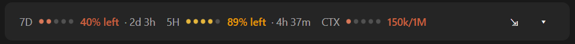
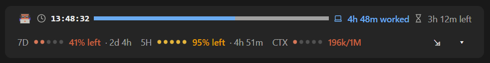

# claude-usage-bar

A Claude Code mod that puts a small usage band right above the prompt bar, so you can see how much room you have left without typing `/usage` or `/context`.



## Best with claude-clock-bar

This mod works best combined with **[claude-clock-bar](https://github.com/ryanary/claude-clock-bar)**, which shows the time and your work hours. Install both and they share the space above the prompt: the clock row on top and the usage row right under it, so they read as one band.



```bash
claude plugin marketplace add ryanary/claude-clock-bar
```

```bash
claude plugin install work-clock@claude-clock-bar
```

## What it shows

**On the band (always visible)**

| Item | What it means |
|---|---|
| **7D** | Your weekly limit: % left and the time until it resets |
| **5H** | Your 5-hour limit: % left and the time until it resets |
| **CTX** | Context: tokens used out of the model's context window. The dots turn yellow at 60% and red at 80% |
| **⇲** (Compact) | Compacts the conversation, the same as typing `/compact`. Hidden while Claude is replying |
| **▾ / ▴** (Show / Hide) | Opens or closes the expanded panel |

**In the expanded panel**

| Item | What it means |
|---|---|
| **IDLE** | Time since Claude's last reply. The bar fills toward 1 hour, when the prompt cache expires |
| **IN CACHE** | Tokens currently held in the prompt cache, and their share of the context window |

## Details

- **No extra cost.** It reads the numbers Claude Code already receives with each reply. It makes no API calls of its own.
- **When it updates.** The numbers refresh after each reply, and CTX also refreshes right after a compaction. Countdowns tick every 15 seconds, and when a reset time passes the limit shows 100% left straight away.
- **Before the first reply** the limits show `–`, because they arrive with the first response.
- **Motion.** The dots pulse in a wave while Claude works, the meters fill, and the cache number rolls like a slot machine. With your system's reduce-motion setting on, it only fades.
- **Desktop and terminal.** The desktop app draws the meters as graphics. The terminal draws them as text.
- **⇲ (Compact) has no confirmation.** One click compacts right away, and a compaction can't be undone.
- **Cache life is assumed to be 1 hour.**

## Install

In a terminal, add this repository as a plugin marketplace, then install the plugin from it:

```bash
claude plugin marketplace add ryanary/claude-usage-bar
```

```bash
claude plugin install usage-bar@claude-usage-bar
```

Start a new Claude Code session, and the band appears above the prompt bar.

### Update

```bash
claude plugin marketplace update claude-usage-bar
```

```bash
claude plugin update usage-bar@claude-usage-bar
```

### Uninstall

```bash
claude plugin uninstall usage-bar@claude-usage-bar
```

## Development

The mod is one file, [`hooks/register.tsx`](hooks/register.tsx), with its tests in [`hooks/usage-bar.test.tsx`](hooks/usage-bar.test.tsx).

```bash
claude plugin validate .
```

```bash
claude plugin test .
```
